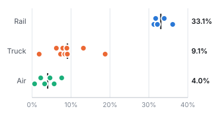
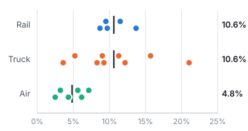
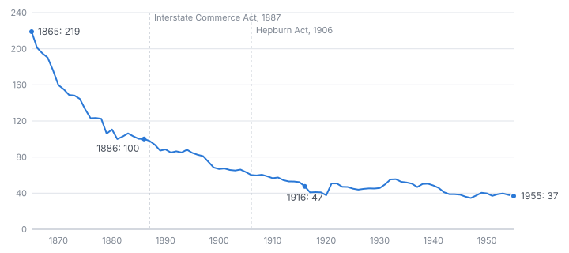
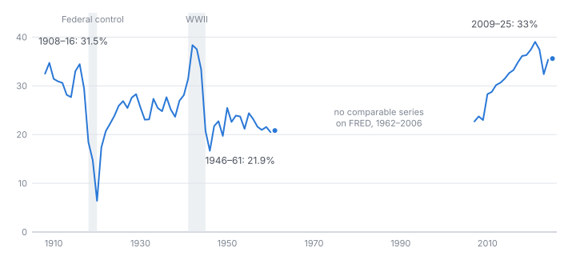

# Hadley Tested

**Private monopolies and public rights, 1830–2025.** An empirical test of Arthur T. Hadley's 1886 essay using SEC filings for 20 US transport companies, NBER historical railroad statistics and FRED price indexes.

**Read the report:** <https://brendynbeasley.github.io/hadley-1886-private-monopolies/> (essay, figures, methodology and results tables)

## The question

In the first issue of the *Quarterly Journal of Economics* (October 1886), Hadley argued that in industries with heavy fixed costs, competition cannot last. Rivals cut prices toward operating cost, ignore interest on the plant, and keep going until bankruptcy or merger, after which prices recover. He concluded that such monopolies should be accepted and regulated through publicity and equal treatment, rather than broken up.

The test uses the distinction Hadley himself draws between the *highway* and the *carrier*. Freight railroads own their track. Truckers and airlines run on public roads, airspace and airports. If Hadley is right, the three should differ in predictable ways.

## Main findings

| | Result | Supports Hadley? |
|---|---|---|
| Operating margin, fiscal 2009–2025 | Rail 33%, trucking 9%, air 4%. Rail vs trucking +23.9 pts, 95% CI 19.9 to 27.9 | Yes |
| Operating return on assets | Rail 10.6%, trucking 10.6%. Difference −0.4 pts, p = .83 | The margin pays for the track |
| Airlines | Return on assets 6.2 pts below trucking (p = .005); fares fell in 11 of 21 years | Yes ("ruinous competition") |
| Real rail rates after deregulation | −31% from 1981 to 2001 while the industry consolidated, +27% since | Yes |
| Real freight rates, 1865–1886 | Fell from 219 to 100 (1886 = 100), and to 47 by 1916 | Yes |
| Railroad stocks in Hadley's crises | −40% (1857), −48% (1872–77), −35% (1881–85) | Yes |
| Construction booms followed by faster rate cuts | No. Lagged correlations are all positive (lag 1: r = +0.29, p = .051) | No |
| Margins under federal rate control | 31.5% (1908–16) vs 23.6% (1921–61, war years excluded), p < .001 | Yes, with caveats |
| Profit volatility by mode | Differs only because of 2020; without it, p = .14 | Not shown |






## Methods in brief

* **Sample.** Purposive sample of 20 SEC registrants: 5 Class I railroads, 9 truckload and LTL carriers, 6 passenger airlines. 322 firm-years, fiscal 2009–2025 (344 with 2007–2008).
* **Primary model.** Pooled OLS of operating margin on mode dummies with year fixed effects, standard errors clustered by firm, t with G − 1 = 19 df:
  `margin_it = β0 + β1·Rail_i + β2·Air_i + γ_t + ε_it` (trucking is the reference group).
* **Checks.** One-way ANOVA and Kruskal-Wallis on the 20 firm means; return on assets as an alternative outcome; capital intensity (log PP&E/revenue) as a covariate; 2020 excluded; 2007–2008 added; Shapiro-Wilk, Levene and Breusch-Pagan diagnostics; power analysis.
* **Historical series.** Spliced revenue per ton-mile 1865–1955 deflated by the general price level; miles built 1830–1952; Class I operating margins 1908–1961; railroad share prices 1855–1937.

Full results are in [`results/modern_results.txt`](results/modern_results.txt) and [`results/historical_results.txt`](results/historical_results.txt). The full methodology (hypotheses, error rates, assumptions, decision rules) is in the report.

## Limitations

* Twenty firms, not randomly drawn. Inference describes these firms more safely than the wider industry, and the return-on-assets test can only rule out a rail premium larger than about 7 points.
* Operating margin and book return on assets are accounting measures, not economic profit.
* Mode and capital intensity move almost in lockstep in this sample, so their separate effects cannot be told apart.
* The 1865–1955 freight-rate series is spliced from four sources; moves near the joins (1882, 1888, 1920) should not be over-read.
* No public series on FRED covers rail rates for 1956–1968 or industry margins for 1962–2006.
* The fall in margins after 1917 coincides with the rise of trucks and cars, so it is not attributable to rate regulation alone.

## Reproducing

Requires Python 3.11 or later.

```bash
python3 -m venv .venv && source .venv/bin/activate
pip install -r requirements.txt
export SEC_USER_AGENT="Your Name your.email@example.com"
make fetch   # download raw data (about 60 MB from the SEC)
make all     # panel, analysis, figures, report
```

FRED data is committed, so `make analysis` for the historical results works without `make fetch`. The modern analysis needs the SEC files, or can run from the committed `data/processed/firm_panel.csv` by skipping `make panel`. FRED revises some series, so a fresh download may shift recent values slightly.

## Repository layout

```
├── src/                  # pipeline: fetch → build_panel → analysis_* → make_figures → build_report
├── data/
│   ├── raw/fred/         # FRED and NBER series (committed)
│   ├── raw/sec/          # SEC company facts (downloaded, not committed)
│   ├── processed/        # analysis-ready CSVs
│   └── README.md         # data dictionary and construction notes
├── results/              # test statistics and regression tables as text
├── figures/              # standalone SVG figures
├── paper/essay.md        # the essay
└── docs/index.html       # the full report (served by GitHub Pages)
```

## Sources

* Hadley, Arthur T. 1886. "Private Monopolies and Public Rights." *The Quarterly Journal of Economics* 1 (1): 28–44. <https://www.jstor.org/stable/1883107>
* U.S. Securities and Exchange Commission. EDGAR XBRL company facts.
* Federal Reserve Bank of St. Louis. FRED. Including Bureau of Labor Statistics price indexes and the NBER Macrohistory Database.
* Background on the Staggers Act and the pending Union Pacific–Norfolk Southern merger: [Railway Age](https://www.railwayage.com/regulatory/the-railroad-staggers-built/), [Logistics Management](https://www.logisticsmgmt.com/article/stb_decision_labels_union_pacific_norfolk_southern_merger_application_as_incomplete/STB), [Supply Chain 24/7](https://www.supplychain247.com/article/union-pacific-norfolk-southern-merger-review-paused/Rail).

## License

Code is released under the MIT License. Text and figures are available under [CC BY 4.0](https://creativecommons.org/licenses/by/4.0/). See [`CITATION.cff`](CITATION.cff) to cite this work.
